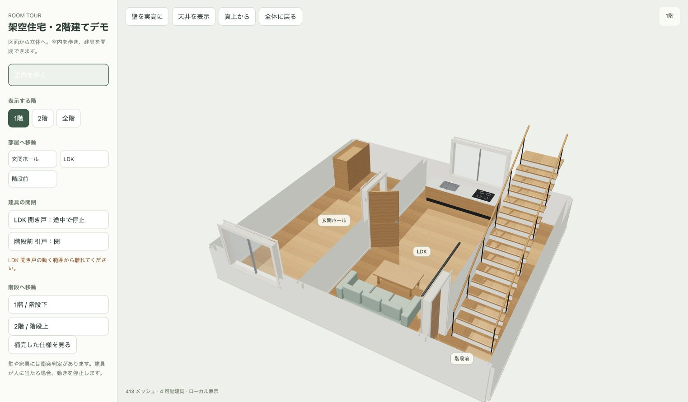

# 住宅ルームツアー — Codexプラグイン

寸法入りの住宅平面図をCodexで読み取り、Blenderの編集可能モデルと、室内を歩きながら建具を開閉できるブラウザ3D内覧を作るプラグインです。

## GitHubのURLをAIへ渡して始める

このリポジトリのURLと図面を、PCのファイル・端末を操作できるAIに渡し、次を依頼してください。

```text
https://github.com/yujirotn/room-tour-production
このリポジトリを使って、このPCの初期設定をして。
README.md、AGENTS.md、制作スキルと公式ドキュメントを読んで、OSと不足ソフトを確認し、
必要なものを公式配布元から導入して、環境診断とサンプル生成を検証して。
その後、添付図面を正確に読み、高品質な3Dモデルを作って。
室内を歩けること、建具を開閉できること、原図照合と実ブラウザでの操作確認まで完成条件にして。
既存のソフトが使える場合は再利用し、図面にない仕様は補完根拠を記録して。
PCを操作できない場合は、必要な公式ダウンロードリンクと、このOSでの導入手順を示して。
```

AI向けの入口は[AGENTS.md](AGENTS.md)、不足ソフトの案内と診断は[初期設定](plugins/room-tour-production/skills/room-tour-production/references/setup.md)です。URLを添付するだけで、すべてのAIがPC操作や指示ファイルの読み込みを行えるわけではありません。上の依頼文を添えてください。

木目・タイルの画像材質、金属・ガラス、面取り、巾木・枠・金具、家具・設備を生成します。描画はThree.jsのPBR材質、環境反射、昼光と室内照明。保存形式は`.blend`、`.glb`、依存を埋め込んだ単一HTMLです。インターネットへ顧客図面を送る処理はありません。



[プラグインZIPと生成済みデモ](https://github.com/yujirotn/room-tour-production/releases/tag/v1.1.0)をダウンロードできます。**完成HTMLを閲覧するだけなら、Node.js・Blender・Git・Codexは不要です。** HTMLをブラウザで開いて操作してください。

## インストール

新規生成にはNode.js22以降・npm・Blender5.1系が必要です。PythonはBlender内蔵版を使うため、別途導入は不要です。Codexはプラグインとして使う場合、GitはcloneまたはGitHub marketplaceの取得に使う場合に用意します。ZIPを展開してruntimeを実行する方法もあります。

不足ソフトは[初期設定の公式リンク](plugins/room-tour-production/skills/room-tour-production/references/setup.md)から導入し、診断で検証してください。診断スクリプト自体はダウンロードやOS設定変更を行いません。

```bash
codex plugin marketplace add yujirotn/room-tour-production --ref main
codex plugin add room-tour-production@aitm-room-tour
```

CLIでmarketplaceを追加した後、Codexのプラグイン一覧から「住宅ルームツアー」を選ぶこともできます。導入手順は[OpenAI公式資料](https://developers.openai.com/plugins/build/plugins)に基づきます。GitHub配布のプラグインです。

図面を添付して、たとえば次のように依頼します。

> この平面図を読み取り、高品質な3Dモデルを作って。室内を歩けて、開き戸・引戸を開閉できるようにして。図面との照合とブラウザ操作まで検証して。

## サンプルを生成

```bash
git clone https://github.com/yujirotn/room-tour-production.git
cd room-tour-production/plugins/room-tour-production/runtime
npm ci --ignore-scripts
npm test
npm run demo
```

上はmacOS/Linuxの例です。Windows PowerShellでは`npm`を`npm.cmd`へ置き換え、Blender実行ファイルを`--blender`で指定します。[OS別の診断・生成コマンド](plugins/room-tour-production/skills/room-tour-production/references/setup.md)を参照してください。WSLではNode/npmとBlenderを同じWSL実行環境に揃えます。Windows実機での生成・操作は未検証です。

`output/demo/walkthrough.html`をブラウザで開きます。Blenderを自動検出できない場合は`BLENDER_BIN`または`--blender`で実行ファイルを指定します。

```bash
node scripts/build.mjs --plan examples/demo-plan.json --out output/my-demo --blender /path/to/blender --render
```

`--render`はCyclesの静止画も生成します。既存HTMLがある出力先は上書きせず停止します。実案件は入力JSONを案件フォルダに置き、顧客成果物をこの公開リポジトリへ保存しないでください。

## 操作

- 「室内を歩く」で歩行開始。WASD・矢印キーで移動、ドラッグで視線、Escで全体表示へ戻る。
- 部屋ボタンで各室に移動。直線階段は歩いて昇降。
- 建具は近づいてEキー、建具クリック、または一覧ボタンで個別開閉。閉じた戸は通行を止め、開けると通れる。
- 階の切替、全体表示、壁高さ切替、天井表示、ミニマップ。

## 対応範囲と検証

v1はメートル単位の直交壁・直交多角形の床、複数階、直線階段、開き戸・引戸、固定窓に対応します。斜め壁、曲線/折返し階段、折戸、可動窓は入力検証で対応外を明示します。必要な形状を無断で近似しません。

PDFの認識はCodexが図面を読んで入力JSONを作る工程です。PDFをコマンドに渡すだけで自動生成するエンジンではありません。高さが図面にない場合は確認した設定を記録します。家具・設備は独自の汎用モデルであり、メーカー製品の精密BIMではありません。

サンプルは新規作成した架空住宅です。顧客図面・顧客モデル・private部品は含みません。サンプルの成功は実案件の正確性を示しません。各案件で図面照合、全室の歩行、全建具の開閉、材質・照明を最終ブラウザで検証します。

- [制作スキル](plugins/room-tour-production/skills/room-tour-production/SKILL.md)
- [初期設定と公式ダウンロード](plugins/room-tour-production/skills/room-tour-production/references/setup.md)
- [入力仕様](plugins/room-tour-production/skills/room-tour-production/references/input.md)
- [実行方法](plugins/room-tour-production/skills/room-tour-production/references/runtime.md)
- [品質チェック](plugins/room-tour-production/skills/room-tour-production/references/quality.md)
- [実読した公式資料](plugins/room-tour-production/skills/room-tour-production/references/official-docs.md)
- [検証記録](docs/validation.md)

## ライセンス

独自のコード・手順・架空サンプルはMIT。[LICENSE](LICENSE)を参照してください。Three.jsとesbuildのライセンスは[第三者ライセンス](plugins/room-tour-production/runtime/THIRD-PARTY-NOTICES.md)へ記載しています。Blender、Node.js、依存パッケージの実体は同梱しません。顧客・メーカー素材の利用許諾はこのライセンスに含まれません。
